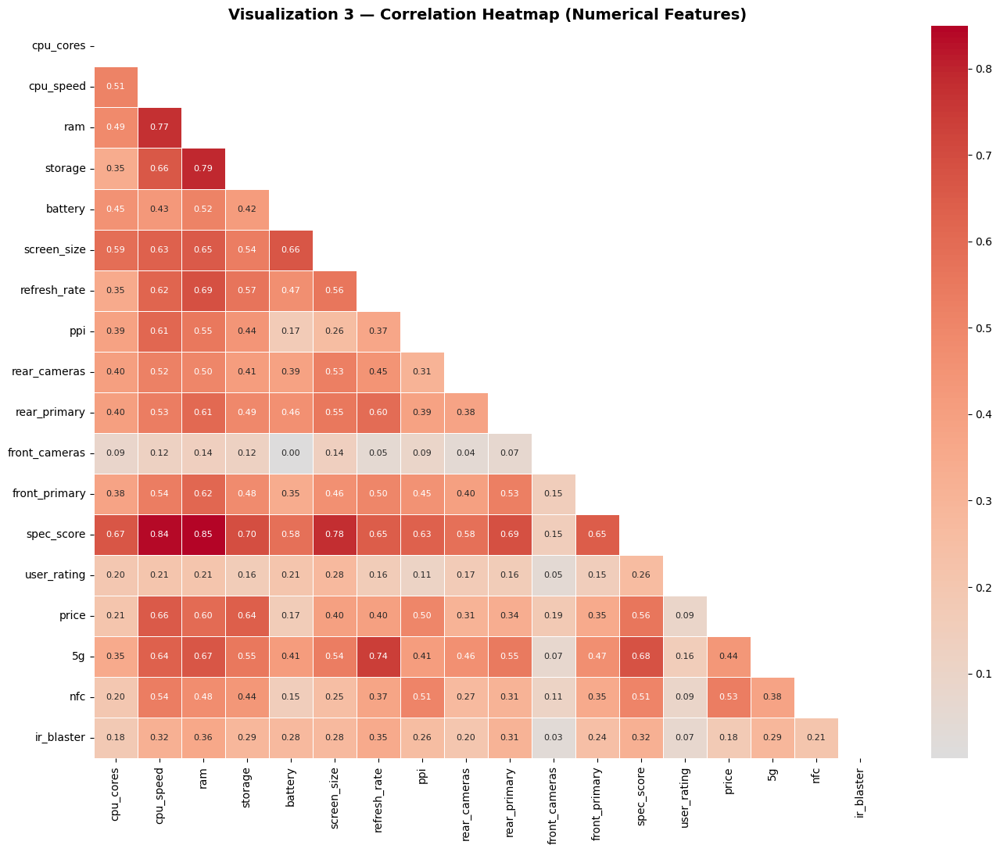
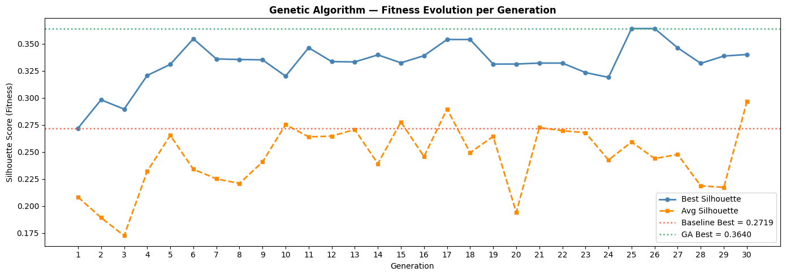
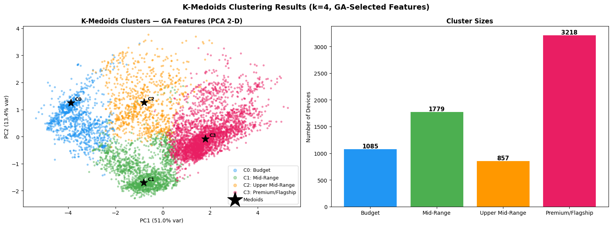
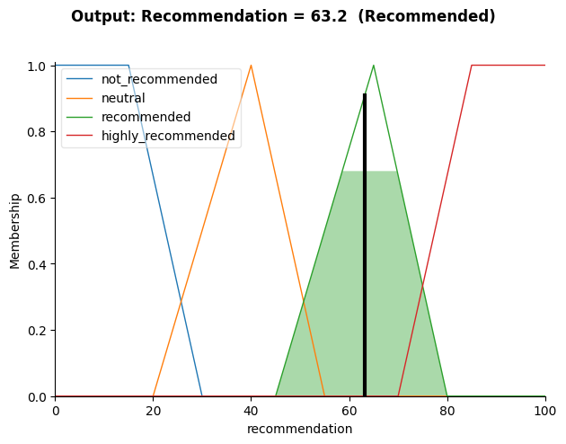
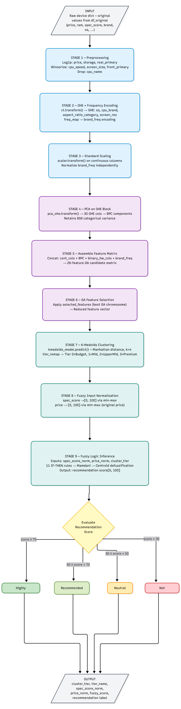

# Smartphone Market Segmentation and Purchase Recommendation

An end-to-end data mining project on 7,166 smartphones sold in the Indian market in 2025. It combines exploratory analysis, preprocessing, a Genetic Algorithm for feature selection, K-Medoids and hierarchical clustering, and a Mamdani fuzzy logic system that turns a phone's spec score, price, and market tier into a purchase recommendation score from 0 to 100. A single pipeline function takes one raw phone record and returns its market tier and a recommendation label.

## Demo

*Correlation Heatmap of Numerical Features*



*Genetic Algorithm: Fitness Evolution*



*K-Medoids Market Tiers (k=4)*



*K-Medoids Cluster Profiles (Mean Feature Values)*


*Fuzzy Output: Centroid Defuzzification for One Device*



*End-to-End Pipeline Flowchart*



## Features

- **Complete Data Mining Workflow:** Exploratory analysis, preprocessing, feature selection, two clustering methods, a fuzzy inference system, and a deployable pipeline, all in one notebook.
- **Justified Preprocessing:** Every transformation has a stated reason and a before/after comparison: dropping or imputing missing values, capping or removing outliers per feature type, log transforms for skewed columns, and one-hot or frequency encoding chosen by cardinality.
- **Targeted Dimensionality Reduction:** PCA is applied only to the 30 one-hot columns (compressed to 8 components) so that category identity cannot act as an artificial cluster separator.
- **Genetic Algorithm Feature Selection:** Binary chromosomes over 28 candidate features, silhouette score of K-Medoids as fitness, tournament selection, single-point crossover, and bit-flip mutation, compared against a random baseline population.
- **Two Clustering Approaches:** K-Medoids with Manhattan distance (cluster centers are real phones) and hierarchical clustering with single, complete, and average linkage, both evaluated with the elbow method and silhouette score.
- **Fuzzy Logic Recommender:** Three inputs (normalized spec score, normalized price, K-Medoids tier), 12 domain-based IF-THEN rules, and centroid defuzzification.
- **Single Pipeline Function:** `phone_recommendation_pipeline()` reproduces every training transformation on a raw record and returns tier, normalized inputs, fuzzy score, and label.

## Tech Stack

- **Language:** Python 3.12 (run in Google Colab)
- **Libraries:**
  - `pandas`, `numpy`: Data manipulation and numerical operations
  - `matplotlib`, `seaborn`: Visualization
  - `scikit-learn`: One-hot encoding, scaling, PCA, hierarchical clustering, silhouette score
  - `scikit-learn-extra`: K-Medoids implementation
  - `scipy`: Dendrograms and linkage matrices
  - `scikit-fuzzy`: Fuzzy membership functions, rule base, and inference
- **Algorithms:** PCA, Genetic Algorithm, K-Medoids, Agglomerative Hierarchical Clustering, Mamdani Fuzzy Inference
- **Data Source:** [2025 Mobile Phones in Indian Market (Kaggle)](https://www.kaggle.com/datasets/kiiroisenkoxx/2025-mobile-phones-in-indian-market-datasets)

## Dataset

7,166 phones from 47 brands and 26 columns. Prices are in Indian rupees (median about ₹16,500, 75th percentile about ₹30,000, maximum ₹480,000).

| Category | Columns |
|---|---|
| Device identity | `name`, `brand`, `os` |
| Processor | `cpu_brand`, `cpu_name`, `cpu_cores`, `cpu_speed` |
| Connectivity | `5g`, `nfc`, `ir_blaster` |
| Hardware | `ram`, `storage`, `battery`, `expandable_upto` |
| Display | `screen_size`, `aspect_ratio_category`, `screen_res`, `refresh_rate`, `ppi` |
| Camera | `rear_cameras`, `rear_primary`, `front_cameras`, `front_primary` |
| Market metrics | `spec_score`, `user_rating`, `price` |

## Methodology

1. **Exploratory Analysis:** Five visualizations with written interpretations: price distribution (raw and log), RAM vs. price by 5G support, correlation heatmap, brand catalogue size vs. median price, and 5G adoption by brand.
2. **Missing Values:**
   - Dropped rows with missing values in columns that were at most 1% null (187 rows, 2.6%).
   - Filled `cpu_speed` with the median.
   - Filled `cpu_brand` and `cpu_name` with the mode.
3. **Outliers (treated by feature type):**
   - Kept as-is: discrete tiers such as `cpu_cores`, `ram`, `refresh_rate`, camera counts, and `user_rating`.
   - Winsorized at the 1st and 99th percentiles: `cpu_speed`, `screen_size`, `front_primary`.
   - Removed with a 3×IQR rule: `battery`, `ppi`, `spec_score` (6,939 rows remain).
   - `log1p` transform: `storage`, `rear_primary`, `price`.
4. **Encoding:**
   - One-hot encoded `os`, `cpu_brand`, `aspect_ratio_category`, and `screen_res` (30 binary columns).
   - Frequency encoded `brand` (47 values) into one numeric column.
   - Dropped `cpu_name` (806 unique values, effectively an identifier).
5. **Scaling:** `StandardScaler` on the 16 continuous columns. `brand_freq` is standardized separately, and binary and one-hot columns are left unscaled.
6. **PCA on the One-Hot Block:** 30 columns compressed to 8 components (BPC1 to BPC8) at the 85% variance threshold (87.2% retained). This gives a 28-feature candidate matrix: 16 continuous, 8 BPC, 3 binary flags, and `brand_freq`.
7. **Genetic Algorithm:** Selects the feature subset that maximizes the K-Medoids silhouette score (see Results).
8. **Clustering:** K-Medoids (Manhattan distance, `k-medoids++` initialization) and hierarchical clustering on the GA-selected features.
9. **Fuzzy Logic:** Mamdani system using the K-Medoids tier as one of three inputs.
10. **Pipeline:** All fitted components are combined into one function that scores a new raw record.

## Results

### Genetic Algorithm

Population of 20, 30 generations, mutation rate 0.05, tournament size 3, minimum of 15 selected features, K-Medoids fixed at k=4.

| | Silhouette Score |
|---|---|
| Baseline (random initial population), best | 0.2719 |
| Baseline (random initial population), average | 0.2083 |
| **GA best solution** | **0.3640** |
| **Improvement over baseline best** | **+0.0921** |

**Selected features (15 of 28):**
- Continuous: `cpu_cores`, `ram`, `screen_size`, `ppi`, `front_cameras`, `spec_score`, `price`
- Categorical components: `BPC1`, `BPC2`, `BPC4`, `BPC7`, `BPC8`
- Binary flags: `5g`, `nfc`, `ir_blaster`
- Dropped: `brand_freq` and the remaining nine continuous features (for example `storage`, `battery`, `cpu_speed`)

### K-Medoids Clustering

| k | 2 | 3 | 4 | 5 | 6 | 7 | 8 | 9 | 10 |
|---|---|---|---|---|---|---|---|---|---|
| Silhouette | **0.409** | 0.336 | 0.364 | 0.369 | 0.287 | 0.245 | 0.305 | 0.288 | 0.282 |

The silhouette score peaks at k=2, but k=4 was chosen because the Indian market is commonly described in four commercial tiers and the fuzzy system needs that resolution. Its silhouette (0.364) is close to k=5 (0.369) and above k=3.

| Tier | Devices | Representative Phone (Medoid) | Profile (z-scored means) |
|---|---|---|---|
| Budget | 1,085 (15.6%) | acer liquid z530 | Lowest on nearly everything: `cpu_cores` -1.76, `spec_score` -1.66, `ram` -1.15, `screen_size` -1.60 |
| Mid-Range | 1,779 (25.6%) | oppo a31 (2020) | Larger screens (+0.34) with low pixel density (-0.85) and below-average `spec_score` (-0.28) |
| Upper Mid-Range | 857 (12.4%) | lenovo p2 | Sharp displays (`ppi` +0.77) and rising NFC use (+0.50), but compact screens (-1.07) and below-average RAM (-0.61) |
| Premium/Flagship | 3,218 (46.4%) | vivo v40 se 5g | Highest `spec_score` (+0.86), `ram` (+0.81), and `price` (+0.72); the only tier where 5G (+0.75) and NFC (+0.62) are standard |

Tiers are ordered by each cluster's mean price.

### Hierarchical Clustering

| Linkage | Best k | Silhouette | Verdict |
|---|---|---|---|
| Single | 2 | 0.449 | Rejected: chaining, one tiny cluster inflates the score |
| Average | 3 | 0.395 | Rejected: 96.1% / 3.8% / 0.1% split |
| **Complete** | **2** | **0.209** | **Selected:** the only balanced split |

Complete linkage at k=2 splits the market into **Budget (4,962 devices, 71.5%)** and **Non-Budget (1,977 devices, 28.5%)**, with a clear `spec_score` gap (-0.32 vs. +0.81). Its low silhouette reflects a soft boundary between the two groups rather than a hard gap. The Adjusted Rand Index against the K-Medoids tiers is only 0.055, so the two partitions share little structure.

### Fuzzy Logic Recommender

**Inputs:** `spec_score_norm` (0 to 100), `price_norm` (0 to 100), and `cluster_tier` (0 to 3, from K-Medoids). **Output:** a recommendation score from 0 to 100.

**Output labels:** 75 or above is Highly Recommended, 50 to 74 is Recommended, 30 to 49 is Neutral, below 30 is Not Recommended.

**Membership functions:** trapezoids at the extremes and triangles in the middle. Spec score has Low, Medium, High. Price has Budget, Mid, Premium. Tier has Budget, MidRange, UpperMid, Flagship.

**Rule base (12 rules, built from Indian-market buying logic):**

| # | Spec | Price | Tier | Recommendation | Reasoning |
|---|---|---|---|---|---|
| 1 | High | Budget | any | Highly Recommended | Best price-performance |
| 2 | High | Mid | Upper Mid-Range | Recommended | Above-average specs, fairly priced |
| 3 | High | Premium | Flagship | Highly Recommended | Premium justified by specs |
| 4 | Medium | Mid | Mid-Range | Recommended | Solid, well-positioned mid-range |
| 5 | Medium | Budget | any | Recommended | Good value for money |
| 6 | Low | Mid | any | Not Recommended | Overpriced for the hardware |
| 7 | Low | Premium | any | Not Recommended | Severely overpriced |
| 8 | Medium | Premium | Flagship | Neutral | Brand premium outweighs hardware |
| 9 | Low | Budget | Budget | Neutral | Expected trade-off, honest product |
| 10 | High | Mid | Mid-Range | Recommended | Punches above its tier |
| 11 | Medium | Mid | Upper Mid-Range | Neutral | Specs do not justify the tier |
| 12 | High | Mid | Flagship | Highly Recommended | Flagship hardware at a mid price |

Rule 12 was added after validation found a combination that no rule covered.

**The cluster tier changes the answer:** the same spec and price inputs give different results depending on tier. For example, Medium spec at Mid price is Recommended in the Mid-Range tier (rule 4) but Neutral in the Upper Mid-Range tier (rule 11). High spec at Mid price is Recommended in the Mid-Range and Upper Mid-Range tiers (rules 10 and 2) but Highly Recommended in the Flagship tier (rule 12).

**Validation on 10 random real devices:**

| Device | Spec (norm) | Price (norm) | Tier | Score | Label |
|---|---|---|---|---|---|
| realme q5 5g | 67.7 | 29.4 | 3 | 83.0 | Highly Recommended |
| xiaomi redmi note 12t 5g | 69.4 | 30.7 | 3 | 85.7 | Highly Recommended |
| asus 8z | 79.0 | 53.5 | 3 | 87.9 | Highly Recommended |
| itel a25 | 19.4 | 3.0 | 0 | 38.3 | Neutral |
| oneplus nord lite | 66.1 | 35.3 | 3 | 78.3 | Highly Recommended |
| vivo x80t pro 5g | 79.0 | 50.9 | 3 | 88.2 | Highly Recommended |
| motorola moto edge 40 lite 5g | 75.8 | 35.3 | 3 | 86.5 | Highly Recommended |
| iqoo z6 pro se | 64.5 | 35.3 | 3 | 76.5 | Highly Recommended |
| lenovo vibe x2 pro | 38.7 | 35.3 | 2 | 38.8 | Neutral |
| motorola moto s50 neo | 77.4 | 30.7 | 3 | 87.2 | Highly Recommended |

A single test case (spec 78, price 42, tier 2) defuzzifies to **63.2 (Recommended)**, as shown in the Demo.

### Key Findings

- **The market is heavily skewed:** about three quarters of the phones are priced under ₹30,000, with a long premium tail. Log-transforming `price` gives a near bell-shaped distribution.
- **Price is only moderately tied to hardware:** `price` correlates with `spec_score` at 0.56 and with `5g` at 0.44, so brand and positioning matter beyond raw specs.
- **Specs are redundant:** `spec_score` correlates with `ram` (0.85) and `cpu_speed` (0.84), and `ram` with `storage` (0.79). Manufacturers bundle high RAM with fast CPUs and large storage.
- **5G is tier-gated:** iQOO (90.8%) and OnePlus (76.9%) treat it as standard, while Samsung (42.1%) and Xiaomi (42.8%) are held down by large budget catalogues.
- **Feature selection helps:** the GA raised the clustering silhouette from 0.272 to 0.364 over the random baseline, using 15 of 28 features. It kept `spec_score` and `price` and dropped `brand_freq`.
- **Hardware and price separate budget phones well:** the Budget tier sits at the bottom on nearly every measure, and the hierarchical Budget group has a clear `spec_score` gap from the rest.
- **Context improves the recommendation:** adding the cluster tier as a fuzzy input lets two phones with identical spec and price receive different recommendations.

### Who Can Use It

- **Consumers:** compare phones by value within their tier instead of by specs or price alone.
- **Retailers:** flag phones with low fuzzy scores as overpriced for markdown or inventory decisions.
- **Manufacturers:** use the GA-selected features and tier profiles to spot gaps between tiers.

## System Implementation

`phone_recommendation_pipeline()` takes one raw phone record (as it appears in the original CSV) plus all fitted components and runs nine stages: preprocessing, encoding, scaling, PCA on the one-hot block, feature matrix assembly, GA feature selection, K-Medoids tier prediction, fuzzy input normalization, and fuzzy inference. A threshold decision then turns the score into a label (see the flowchart in the Demo).

```python
result = phone_recommendation_pipeline(
    raw_record=test_record, ct=col_t, scaler=scaler, pca_ohe=pca_ohe, freq_map=freq_map,
    cont_cols=cont_cols, ohe_block_cols=ohe_block_cols, binary_cols=binary_cols,
    bpc_cols=bpc_cols, selected_features=selected_features, kmedoids_model=kmedoids_model,
    tier_remap=tier_remap, phone_ctrl=phone_ctrl, df_original=df_original,
)
# {'cluster_tier': ..., 'tier_name': ..., 'spec_score_norm': ..., 'price_norm': ...,
#  'fuzzy_score': ..., 'recommendation': ...}
```

## Getting Started

### Prerequisites
- Python 3.12 (or Google Colab)
- Jupyter Notebook or JupyterLab (if running locally)

### Installation

Clone the repository:
```bash
git clone https://github.com/YourUsername/smartphone-market-segmentation-fuzzy-recommender.git
cd smartphone-market-segmentation-fuzzy-recommender
```

Install the dependencies (the notebook was run with these pinned versions):
```bash
pip install pandas==2.2.2 numpy==1.26.4 matplotlib seaborn scikit-learn scikit-learn-extra scipy scikit-fuzzy jupyter
```

### Usage

Place `mobiles.csv` next to the notebook and run `smartphone_market_segmentation.ipynb` from top to bottom. The notebook trains and saves everything in memory, so run all cells in order before calling the pipeline function.

## Limitations and Future Work

- **Choice of k:** the silhouette score peaks at k=2 (0.409); k=4 (0.364) was chosen from domain knowledge. Tier names come from ranking clusters by mean price, so the Premium/Flagship tier holds 46% of all phones, and the Upper Mid-Range tier has below-average RAM and spec score.
- **Weak agreement between clusterings:** K-Medoids (4 tiers) and hierarchical (2 groups) agree only weakly (ARI 0.055).
- **GA settings:** the population is small (20), the best solution used exactly the minimum of 15 features, and each fitness value uses a 1,500-point silhouette sample, so scores are noisy. Multiple seeds, a larger search, and an elitism step would make the result more reliable.
- **GA objective:** it maximizes cluster separation, not recommendation quality.
- **Imputation:** 14% of `cpu_brand` and 11% of `cpu_name` values were filled with a single mode.
- **Rule base:** the 12 rules do not cover every input combination, and membership shapes and thresholds were set by hand. In the validation sample, 8 of 10 phones came out Highly Recommended, so the system is generous. Comparing scores against `user_rating`, and running a sensitivity analysis on the membership functions, would help calibrate it.
